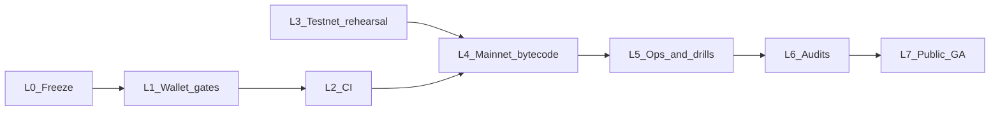

# Mainnet launch

Task list from the current tree to a public mainnet. Policy and threat model stay in [Simple wallet mainnet assurance](wallet-mainnet-assurance.md) and [ROADMAP.md](https://github.com/naiemk/onchain-invoice/blob/main/ROADMAP.md). This page is the ordered work.

**Today:** Ethereum Sepolia is the live reference (contracts, API, sweeper, UI, gateway). Tron Nile and Solana Devnet commerce code exists. Base mainnet is labels in the UI. Identity wallets run on the local and Sepolia stacks. No production-chain deploy artifact is committed. Simple-wallet assurance is at P0 (the program doc). System tests pass against published Sepolia images.

## What “launched” means

Public `https://trustless-commerce.com` is up, and all of the following are true:

1. A small real invoice can be created, paid, and swept on **Base (8453)**, **BNB Chain (56)**, and **Tron mainnet**.
2. A hosted **simple wallet** on Base can be created, funded only after a second on-chain method, used to send, restored by email through the operator, and cancelled by a remaining key. `restoreDelay` is 259200 seconds.
3. User Super Wallet is in the product with a beta label. It is outside the certification.
4. Identity audit P0/P1 are closed. Commerce audit P0/P1 are closed before public traffic.
5. A commit that breaks simple-wallet recovery or UserOp authorization fails CI on `main`.

Ethereum mainnet, Arbitrum, Solana mainnet, HMAC partner-wallet certification, and user Super certification are follow-ons. They are listed at the bottom and are not part of this launch.

Private contract deploys and operator drills happen before the public cutover. Deploying bytecode is not the launch.

## How to read a row

Each task has an id, what to build, and a definition of done that a reviewer can check without a meeting. Check the box when the definition of done is true on `main`.

---

## 0 — Freeze the surface

Do this before changing Identity contracts. A later factory deploy binds the bytecode you ship.

| ID | Task | Description | Definition of done |
|----|------|-------------|-------------------|
| [x] L0.1 | Super Wallet beta label | User `enableSuper` stays available and is labeled beta: unaudited, the user can stay on a simple wallet. Copy must match the chain: Identity `enableSuper` does not call `disableRestore`. | UI convert flow and any legal/help string say beta. A test or screenshot review shows the string. No user-facing string says Identity `enableSuper` turns off email recovery. |
| [x] L0.2 | No new hosted legacy wallets | Hosted `/wallet` on mainnet creates IdentityWallet accounts only. `Wallet.sol` + `AdminGuardianRecovery` stay for wallets that already exist. | Wallet create and public wallet-config on a mainnet-mode build refuse a new legacy account. A test covers that refusal. |
| [x] L0.3 | Launch tag rule | Identity implementation, factory, and store are frozen before the Base deploy. A new implementation means a new factory and new addresses. `scripts/deploy-identity-wallet.ts` writes `gitTag` on the artifact. | `docs/wallet-mainnet-assurance.md` and this page state that rule. The Base deploy task (L4.4) records the git tag it deployed. |

---

## 1 — Wallet safety in the product

Critical path A is recoverability. Critical path B is fund safety. These tasks close the holes the assurance doc already names.

| ID | Task | Description | Definition of done |
|----|------|-------------|-------------------|
| [x] L1.1 | Second method before funds | The product treats a simple wallet as fundable only after the identity has at least two on-chain methods (passkey plus EOA or YubiKey). Until then the receive address stays hidden. | With one method, the receive UI does not show the address and does not start a send. After a second method lands on the store, the address appears. Playwright covers both states. |
| [x] L1.2 | Deployer waits for the second method | `wallet-deployer` does not call `createAccount` until the identity has at least two methods. A USDC transfer that arrives early is still recoverable through the persist log and a later deploy. | A one-method funded counterfactual stays code `0x` after a deployer tick. After the second method, the same tick deploys it. A test covers both. |
| [x] L1.3 | Last method cannot be removed while restore is off | If `restoreEnabled == false`, `removeMethod` reverts when it would leave zero methods. | Hardhat: disable restore with two methods, remove down to one, the next remove reverts, and the remaining method can still send. |
| [x] L1.4 | `disableRestore` needs two methods | `disableRestore` reverts when `methodCount < 2`. | Hardhat: one-method identity cannot disable restore. Two-method identity can. Email restore is blocked after a successful disable, and the other key can still add a method. |
| [x] L1.5 | Cancel beats execute | A cancel mined before the delay wins against `executeRestore`. | Hardhat (F8): pending restore, cancel, then execute reverts. The old method still spends. |
| [x] L1.6 | Production ignores the restore override | `IDENTITY_RESTORE_ENABLED` is a test hook. tcmain must not boot with it set. | tcmain env examples omit it. A production-like config that sets it fails boot. A test covers the failure. |
| L1.7 | Store owner is slow | Production `IdentityStore` owner is a timelocked multisig. `setRecoveryOperator` and `setRestoreDelay` are break-glass through that timelock. | Design is written (delay, owners, how tcmain points at it). The Base deploy uses that owner. A test or script shows a direct EOA owner cannot call those setters on the production store. |

---

## 2 — CI that protects the bar

A later commit has to go red if recovery or spend authorization breaks.

| ID | Task | Description | Definition of done |
|----|------|-------------|-------------------|
| L2.1 | `wallet-cert` Hardhat suite | One tagged suite for the matrix and threat rows that are contract tests: IdentityStore delay, cancel, execute, disable; last-method and disableRestore gates; IdentityWallet UserOp and AA24; reco 2-of-3 `initiateRestore`; spend after restore; spend after disable via the remaining EOA or YubiKey; F8. | `npm test` (or the documented `wallet-cert` script) runs that set on every PR. The job is required on `main`. |
| L2.2 | Email-restore CI | The hosted email path (operator signature, second signature executes, cancel, funded send, restore disabled) runs in GitHub Actions. | `.github/workflows/ci.yml` runs `ui/e2e/identity-email-restore.spec.ts` or a headless subset, required on `main`. A red run blocks merge. |
| [x] L2.3 | Bytecode snapshots | ABI and bytecode of IdentityStore, IdentityWallet, and IdentityWalletFactory are snapshotted. | A PR that changes those bytecodes fails until the snapshot is updated in the same PR. The snapshot file names the compiler version. |
| L2.4 | CODEOWNERS | Identity contracts and the cert tests need a review from the owner. | `CODEOWNERS` covers `contracts/wallet/Identity*.sol` and the `wallet-cert` tests. A PR without that review cannot merge. |
| L2.5 | Matrix evidence | Every cell S1–S12 and F1–F12 in the assurance doc points at a test id or an ops procedure id. | The assurance doc has no `TBD-*` left. Each id resolves to a test name or a section in the operator runbook (L5.5). |

---

## 3 — Invoice rehearsals

Mainnet deploy follows a public-testnet pay and sweep on the rails that do not have one yet.

| ID | Task | Description | Definition of done |
|----|------|-------------|-------------------|
| L3.1 | Base Sepolia commerce | Deploy the invoice sweeper and forwarder on Base Sepolia (84532). Wire API and sweeper config. UI offers that network only with the deployed addresses. | `data/commerce-deploy-base-sepolia.json` is committed. A script or system test creates an invoice, pays test USDC, and records a sweep tx hash. |
| L3.2 | Tron Nile live smoke | The Nile path already creates invoices. Finish one live payment. | Operator log: Nile USDT in, invoice marked paid, sweep tx, merchant balance moved. The hash is written in the deploy notes. |

---

## 4 — Deploy mainnet bytecode

Same seed, owner, and fee recipient on each EVM chain. Salt includes `chainId`, so addresses differ. Record addresses. Do not commit private keys.

| ID | Task | Description | Definition of done |
|----|------|-------------|-------------------|
| L4.1 | Base commerce contracts | CREATE2 `CommerceInvoiceSweeper` and forwarder on Base mainnet. | `npm run mainnet:invoice-smoke` passes for chain 8453 against the deployed bytecode. Artifact committed. Addresses copied into the tcmain API and nodes env. |
| L4.2 | BNB commerce contracts | Same CREATE2 deploy on BNB Chain (56), USDC and USDT allowlist locked to the Binance-pegged token addresses already in `server.example.yaml`. | Smoke passes for chain 56. Artifact committed. Env copied. |
| L4.3 | Tron mainnet config | Tron has no commerce contract deploy. Production uses the master secret, `TRON_USDT_ADDRESS=TR7NHqjeKQxGTCi8q8ZY4pL8otSzgjLj6t`, and `TRON_FULL_HOST=https://api.trongrid.io`. | tcmain env has those values. A create on chain id `tron` returns a mainnet invoice address. The secret is only on the server. |
| L4.4 | Identity stack on Base | `npm run wallet:deploy:base` from the tag in L0.3. Fund the bundler and the wallet-deployer. | Artifact committed with store, factory, implementation, and the git tag. `restoreDelay` on the store is 259200. tcmain `IDENTITY_STORE_ADDRESS` and factory addresses match the artifact. `IDENTITY_RESTORE_ENABLED` is unset. |
| L4.5 | Recovery operator | Point `recoveryOperator` at the reco 2-of-3 Super Wallet. That wallet is operator infrastructure. | On-chain `recoveryOperator` equals that Super. A throwaway identity’s `initiateRestore` succeeds only with a threshold of that Super. The tx hash is in the drill log. |

---

## 5 — Production stack and drills

tcmain is a separate API, database, and sweeper from tctest.

| ID | Task | Description | Definition of done |
|----|------|-------------|-------------------|
| L5.1 | tcmain env | Fill the mainnet API and nodes env from the deploy artifacts. Distinct admin and sweeper keys from testnet. `AUTO_UPDATE=0` on mainnet nodes. `SWEEPER_CHAINS=8453,56,tron`. | `deploy/README.md` checklist items 2–4 are true on the host. Testnet keys do not appear in the mainnet env. Nodes do not auto-update. |
| L5.2 | Processes up | `mainnet-api` is behind the host gateway. Sweepers, bundler, and wallet-deployer are registered and healthy. | `GET /api/health` on the public mainnet host is 200. Sweeper `GET /api/sweeper/me` is 200 for the production key. Gateway upstream is the mainnet API, not tctest. |
| L5.3 | Invoice drills | One small real payment on each launch chain, from create through merchant payout. | Three tx hashes (Base, BNB, Tron), each with invoice paid and swept. Amounts are the operator’s smoke size, recorded in the drill log. |
| L5.4 | Wallet drills | Throwaway identity on Base, in order: unfunded email restore, funded restore then a send, cancel during the delay, `disableRestore` plus an EOA add, persist-log replay after a SQLite wipe. | Drill log lists each step with a tx hash or a job id. The wiped API, after replay, logs in with the restored method and can send. |
| L5.5 | Runbooks and monitoring | Procedures for S10 (operator Super down, request stuck `awaiting_operator`), S12 (worker down after the delay: anyone may `executeRestore`), and store-owner break-glass. Alerts on recovery job age, `awaiting_operator`, failed execute, and store-owner transactions. | Runbook is in `deploy/operator/` or `docs/ops.md` and linked from the assurance matrix. A forced `awaiting_operator` in a drill shows up in the alert channel. SQLite and the persist log both have a tested backup restore. |

---

## 6 — Audits

Audits review the tag that was deployed, not whatever `main` is the week the report arrives.

| ID | Task | Description | Definition of done |
|----|------|-------------|-------------------|
| L6.1 | Identity audit | External review of IdentityStore, IdentityWallet, IdentityWalletFactory, IdentitySigLib, IdentityTypes, IdentityErrors, and the operator Super only as `recoveryOperator`. | Report is filed. P0 and P1 are fixed, `wallet-cert` is green on the fix, and the deployed bytecode matches the audited tag or a documented redeploy. Residuals (email plus operator, Super beta, store-owner timelock) are published. |
| L6.2 | Commerce audit | External review of the sweeper and forwarder, Tron settle path, invoice address derivation, payout binding, admin key, and sweeper signatures. | Report is filed. P0 and P1 are fixed and the M2/M3 smoke paths are re-run. Residuals are published for merchants. |

---

## 7 — Public cutover

| ID | Task | Description | Definition of done |
|----|------|-------------|-------------------|
| L7.1 | Mainnet UI | UI build uses `VITE_DEPLOYMENT_MODE=mainnet` (or a hostname without `testnet.`). The network list contains only chains with a live artifact and RPC from this launch. | Production UI offers Base, BNB, and Tron. It does not offer Sepolia, Nile, or a chain with an empty sweeper address. A create on each offered chain hits the mainnet API. |
| L7.2 | Simple wallet GA | Hosted `/wallet` on the production host uses the Base identity stack from L4.4. Super convert still shows the beta label from L0.1. | A new user can create a simple wallet, add a second method, receive, and send on production. Receive stays hidden before the second method. Email restore matches the drill in L5.4. |
| L7.3 | Docs for integrators | Chain matrix for agents: chain id, token addresses, pay-link example, and which chains are mainnet. | `docs/index.md`, `docs/agents.md`, and the invoice skill describe Base, BNB, and Tron mainnet. Sepolia remains documented as the testnet. A fresh reader can create a mainnet invoice from the docs alone. |

When L7.1–L7.3 are done, check P5 in [ROADMAP.md](https://github.com/naiemk/onchain-invoice/blob/main/ROADMAP.md) and the P5 row in the assurance doc.

## Order

L3 can run beside L1 and L2. L4.4 waits until L0.3, L1, and L2.1 are done so the factory is not deployed twice. L7 waits until L6 P0/P1 are closed.

L2.1 and L2.2 have CI jobs (`wallet-cert`, `identity-email-restore`). They stay open until those jobs are required checks on `main`. `CODEOWNERS` covers the identity contracts and cert tests; L2.4 stays open until that review is required to merge. L1.7 has the timelock contract and a Hardhat test; the Base store owner is still assigned at L4.4. L2.5 still has `TBD-*` cells for the operator runbooks.

## Follow-ons

These stay out of the launch definition:

- Solana mainnet program deploy and mainnet-beta invoices
- Ethereum mainnet settlement
- Arbitrum and other L2s
- User Super Wallet certification
- HMAC partner wallet recovery certification
- Multi-chain identity wallets
- Foundry invariant campaign
